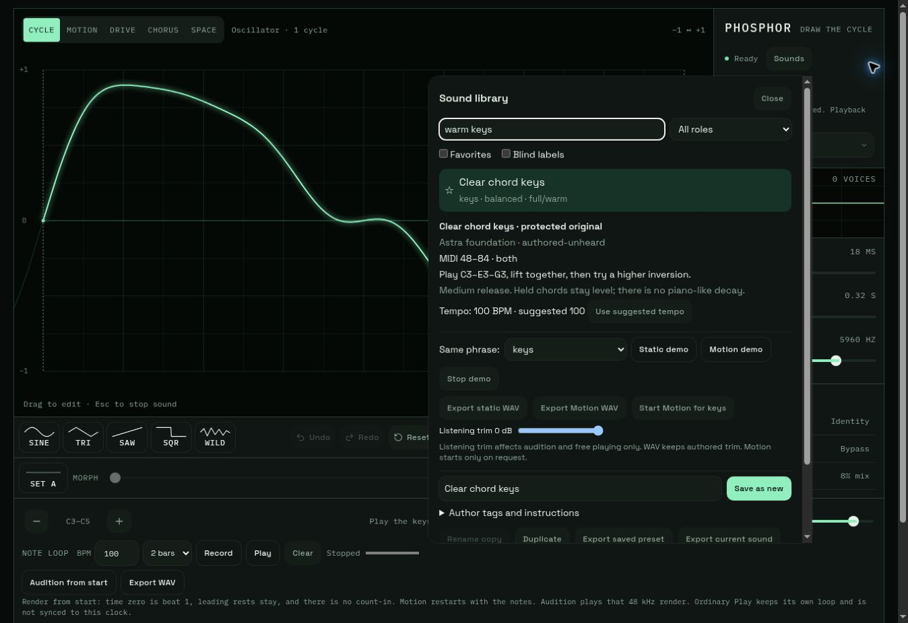

# Preset foundation follow-up — 1 November 2026

The requested foundation was already present in draft PR #18 at `eef1048c94e9643522871a32f9317720f3e6177e`. This pass inspected that implementation and the source of PRs #14–17, then continued in the isolated branch `review/phosphor-preset-verification-2026-11-01`. It did not write to the original review branch, retarget another PR, merge, or deploy.

The [original foundation decision](REVIEW.md) remains appropriate: #17 supplies whole-session persistence and production phrase rendering; #15 supplies the sound family and legacy migration. Sound v2 separates DSP from metadata, tempo, monitor and performances. #14's study removal and #16's seamless-loop exporter remain separate. Main is still `067b8fd6a39a55d8db6ed85ec5c9088f3519028b`.

## Corrections

- A failed legacy shelf migration previously warned but permitted a later Save/favorite/remove to create a new v2 shelf, hiding the old entries on the next visit. Such a failed initialization now blocks mutations. Factory sounds can still be played/exported, and the original stored bytes remain intact.
- Shelf writes and migrations now validate the complete storage shape and ID/audition-ID collisions before creating the new key. Unknown saved fields are rejected instead of disappearing on a later save. Two new regression groups failed on the previous code and passed after these corrections.
- Save as new failed on the managed HTTP audition URL with `crypto.randomUUID is not a function`. IDs now use cryptographic `getRandomValues` to construct UUID v4 values, retaining the same namespaced ID format. This covers Save, Duplicate and bare sound/session import without requiring HTTPS-only `randomUUID`. There is no weak-random fallback. A third regression group covers this path.
- Vite explicitly accepts the managed preview's exact `terminal.local` hostname. Localhost defaults and production output remain unchanged.

No engine or sound-schema changes were needed. The four starter DSP payloads are unchanged.

## Fresh verification

| Check | Result |
|---|---|
| Synth/DOM/contract tests | 181 pass, 0 fail |
| Existing string-study tests | 94 pass, 0 fail |
| TypeScript / production build | Pass; the full four-starter bundle still triggers Vite's >500 kB advisory |
| Starter pack validator | Four entries accepted; no listening approval implied |
| Browser phrase-render page | 35 checks pass |
| Browser preset-render page | 20 checks pass |
| Extracted neutral ZIP | Fresh dependency install, typecheck, build, canonical validation, six-entry template generation and round-1 validation pass |
| Pinned file hashes | All 27 engine/schema/demo hashes match the extracted ZIP |

The browser used the managed preview and then the actual built static files. Through the UI: `warm keys` search, loading at an existing 91 BPM, recording a C3 note, switching sounds with the completed take retained, stopped reload, Save as new, rename, duplicate, favorites, blind labels, canonical file import and unsupported-file rejection all worked. Pad Static and Motion demos were explicitly started in development; the built production bundle loaded and played the keys Static demo. No human acoustic or musical listening is claimed.

The browser rendered the four static role performances, pad Motion, all four 12-voice stress chords, restored-pad rerender and trim/cancellation comparisons. WAV encoding/decoding preserved the rendered PCM exactly; restored pad Motion was sample-identical. Leading rests and tails passed. Representative 12-voice peaks were 0.287–0.328; static/Motion mono RMS retention was 0.962–1.000 (the pad stress chord was 0.958). These measurements reproduce the earlier fixtures; they are not universal bounds or perceptual scores.

One browser download returned a temporary path that was unavailable for re-upload; that attempted UI file round-trip was not counted as passed. The independently supplied canonical fixture did import successfully through the real picker. The automated WAV PCM round-trip and sound document round-trip both passed. Safari, iPhone, physical keyboard feel and speakers remain untested in this pass. The prior 390 px screenshots/checks were inspected but not rerun with a resized browser here.

## Deliverables and exact pin

- Runnable instrument and [four starter presets](../../src/presets/starter.pack.json).
- [Neutral contributor kit ZIP](../../review-artifacts/phosphor-contributor-kit.zip), pinned to source `a35e1186c2e5bd744e51ac89aa56fe85398bfad7`.
- ZIP SHA-256: `1a5d1c881f9f37b412d037ee63edbbeaab1704aeadd9925de7eb2d763a20310e`.
- [Ready-to-send common brief](../../contributor-kit/README.md), [capabilities](../../contributor-kit/CAPABILITIES.md), [contract/adapters](../../contributor-kit/CONTRACT.md), [five-minute audition](AUDITION.md).
- [External starter reveal map](../../contributor-kit/starter-reveal.json), excluded from the neutral kit.

The ZIP contains one neutral technical example, production source, exact dependency lock, timed role performances, canonical validator and six-sound template/reveal commands. It excludes the proof bank, its recipe, other banks and the reveal map. Give this same ZIP independently to Claude, Grok, Gemini and the next Astra. First round: six sounds each. Only after Charlie's listening: up to two gap-filling additions each.

The sounds remain authored-unheard. Keys sustain while held; short release does not supply a pluck decay. Shared Motion starts only by an explicit action. Ordinary live playback and 48 kHz phrase rendering have different clocks and sample-rate-dependent Space, so no live/offline equivalence is claimed.
